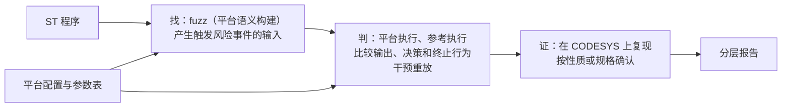

# 计划书

2026-10-18 初稿，2026-10-19 依据外部评审修订

本文依据[研究方向](research_direction_zh.md)，结合现有的 SemantiST，列出从现在到投稿的全部工作：分几个阶段，每个阶段做什么、产出什么、怎样算完成，以及没有通过时怎么办。第 1 周从 2026-10-19 算起。

本版的主要变化：

- 增加 G0 基线对齐；
- 阶段 1 先定首版语义范围表，判据验证集的预期结论在设计规则之前固定；
- 参考执行按运算类型规定，比较的对象改为输出、决策和终止行为；
- 干预归因只给出经重放验证的干预集合；
- fuzz 的候选不再只保留每个位置的首次命中；
- 评测把"用固定输入比较判据"和"端到端比较"分开。

修订的理由见研究方向文末。时间表是资源安排的假设，进度以关口的证据为准。

## 0. 总览

工具做完后的完整流程：

| 阶段 | 内容 | 时间 | 关口 |
| --- | --- | --- | --- |
| 0 | 基础修复（已完成）与基线对齐 | 第 1 周 | G0 |
| 1 | 判据验证：首版语义范围表；预先固定预期结论的验证集 | 第 1–3 周 | G1 |
| 2 | 平台配置与参数表、虚拟时钟、原生确认流程 | 第 2–4 周 | G2 |
| 3 | 自动化判定器，接入 fuzz | 第 5–8 周 | G3 |
| 4 | 应用级案例 | 第 7–9 周 | — |
| 5 | 正式评测 | 第 10–13 周 | G4 |
| 6 | 写作与披露 | 贯穿始终，第 14 周起为主 | — |

## 1. 现有工具的角色

| 组件 | 现在能做什么 | 在新方向中的角色 | 要做的改动 |
| --- | --- | --- | --- |
| RuSTy 编译、STG 与 IR 插桩（`compiler/`） | 找出每个有风险的运算，并在运行时判断它是否出错：除法、整数溢出、浮点非有限值、数组越界、截断 | "找"：标记第一层的风险事件 | 整数溢出改为按参数表中的中间结果宽度判断 |
| harness 生成（`compiler/harness/`） | 布局取自编译器；FB 可以连续跑多个扫描周期 | "找"和"判"共用 | 加虚拟时钟；记录初始状态和扫描序号 |
| fuzz 引擎（`fuzzer/engine/`、`fuzzer/semantic/`、`fuzzer/scheduler/`） | 把输入引向风险点，到达出错点就保存输入，在线去重。语义候选按（目标、类型、危险）只保留首次命中的输入 | "找" | 同一风险位置保留多个代表输入；fuzz 使用平台模式构建；进展度量改为到出错边界的距离；执行效率优化正在进行 |
| 重放与分类（`fuzzer/reporting/`、`experiments/comparison/analysis/replay.py`） | 重放崩溃，并分为工具链 panic、harness 错误、目标缺陷。这里的"目标缺陷"只表示崩溃发生在目标代码中并且可以复现，不是 PLC 上确认的缺陷 | "判"的入口 | 扩展为判定流程；记录时钟、初始状态和重放是否完整 |
| 对比实验框架（`experiments/comparison/`） | 运行 SemantiST、AFL++、ICSQuartz，统一导出指标 | 评测中的"生成器" | 补齐 ICSQuartz 的输入转换；解决 AFL++ 拒绝会崩溃的初始种子、local-bounds 检测只在 SemantiST 构建中启用的问题；对齐各工具的 FB 执行模型 |
| 基准（`benchmarks/`） | 90 个目标：OSCAT Basic 61 个（31 个 FUNCTION、30 个 FB），ICSQuartz 注入缺陷的基准 29 个 | OSCAT 部分进开发集；ICSQuartz 部分以内存越界为主，不在第一版范围内，只用来检查搜索能力没有退化 | 无 |
| 普查 CSV（`docs/improvement/*.csv`）与 7 个已知问题 | 人工审计的结果 | 开发集真值 | 整理成机器可读的格式，注明来源、分类依据和原生核验状态 |
| 校准包（`experiments/calibration/`） | CODESYS 与 RuSTy 的逐项对照 | 产出平台参数表 | 补上 CODESYS 的结果和工程的检查设置 |

**新增的部分**：语义范围表、判据验证集、平台配置与参数表、虚拟时钟、可切换语义构建、替代值运行、行为比较、干预重放、候选保留、原生确认流程。

**保留但不再投入的部分**：路径搜索与五维 effort 公式、复杂的抽象状态遥测、快进、LLM 报告文本。

## 2. 阶段 0：基础修复与基线对齐

### 2.1 已完成的修复

- 已完成的修复：
  - harness 布局改为取自编译器；
  - `ADR(x) + n` 改为按字节计算；
  - 崩溃按签名去重，并记录首次发现时间；
  - 重放时对崩溃分类；
  - 修复变异器把 64 位整数当成 LREAL 的 bug；
  - 修复重放预算误含容器启动时间的问题。
- 在新镜像上跑的 smoke 和 P0 验证都已通过，详见[现状说明](project_status_20261018_zh.md)。
- 校准包已完成，RuSTy 一列已填好。
- `fix/p0-harness-fidelity` 已合并到 main。

**进行中**：执行效率优化（状态复位、AFL++ persistent 模式、进程内执行），在另一个会话中进行，完成后复核。

**遗留**：有 15 个修改前就失败的 Python 测试。

### 2.2 基线对齐（第 1 周）

外部评审看到的是一份旧的工作副本，与服务器上的状态不一致。以后讨论和排期，都以一份明确的基线记录为准。执行效率优化完成后，在现状说明的基础上补齐，内容包括：

- 源码提交、镜像摘要、工具链版本；
- 测试结果和已知失败；
- 各组件的实际能力和限制，例如第 1 节表中写明的重放分类含义和候选去重方式；
- 校准材料和普查数据的状态。

**关口 G0**：基线记录写完，能力和遗留问题都已列明。没有写进基线的完成状态，不作为排期依据。

## 3. 阶段 1：判据验证（第 1–3 周）

**目的。** 在做任何自动化之前，先确认三件事：

1. 三层结论和几种不确定结论的含义是明确的；
2. 首版范围内的每类运算，参考语义都能写成可执行的定义；
3. 关键反例都能得到合理的分类。

这是整个方向能否成立的关口。

### 3.1 首版语义范围表

先写出下表，作为阶段 1 和阶段 3 的共同依据。平台一列先按 RuSTy 的行为和 CODESYS 文档填写，标为待校准，阶段 2 拿到 CODESYS 的实测结果后替换。

| 运算 | 平台执行 | 参考执行 | 适用条件与边界 | 定义不了时 |
| --- | --- | --- | --- | --- |
| 整数 + − ×（含不赋值的中间结果） | 按平台的中间结果宽度计算，在赋值或转换处截断 | 用更宽的整数（首版用 LINT）保留精确值 | 参考值超出 LINT 时，标为"参考越界"；原类型已是 64 位的，首版只记风险事件 | — |
| 隐式窄化（赋值、传参、返回值） | 按平台截断 | 保留宽值，后续运算继续用宽值 | 宽值进入位运算或显式窄化时，按下一行处理 | 按引用传递（VAR_IN_OUT）、依赖类型的重载等情况，记为不支持 |
| 显式窄化、位运算、移位 | 按模 | 按模。这是规定，可能漏报，例如 FRMP_B 把 `SHL(x, 8)` 当乘以 256 用 | — | — |
| 比较、分支条件 | 用平台值 | 用参考值 | — | — |
| 时钟读取与时间差 | 虚拟时间 τ mod 2^w | 不回绕的 τ | 时钟来自虚拟时钟 | 程序对时钟值做位运算时，记为不支持 |
| TIME 的加减 | 按平台的位宽和单位 | 更宽的整数 | 单位换算按参数表 | — |
| DIV、MOD 除以零；最小值除以 -1 | 按平台：陷入、返回某个值，或由检查函数处理 | 参考未定义 | — | 用多个替代值运行（见下） |
| REAL 转整数越界 | 按平台 | 有限值：按平台的取整方式得到精确整数 | NaN、INF 没有对应的整数 | 参考未定义，用多个替代值运行 |
| 浮点运算 | 不改 | 不改 | NaN、INF 只作为风险事件记录 | 一般的浮点精度问题不在首版范围 |

**替代值运行。** 对参考未定义的事件，不指定一个"正确值"，而是分别用几个替代值运行：平台值、0、1、被除数、类型的最大值和最小值。

- 输出、决策和终止行为在所有替代值下都与平台执行相同：未观察到影响；
- 随替代值而变：输出依赖一个未定义的结果，记为影响候选。

用加宽实现参考执行时要注意两点：加宽到固定位宽不等于无限精度，再次越界要标出来；加宽还可能改变重载选择、隐式转换、位运算、循环行为和函数接口，遇到这些情况就退出为不支持。

### 3.2 判据验证集

**防止循环验证。** 如果用例的预期结论和判定规则由同一个人按同一套想法写出，结果一致只能说明内部自洽。所以：

- 主要用例和预期结论在设计判定规则之前写好并提交，之后不再改预期；确实写错了的，单独记录修改理由；
- 每类情况另备一个独立变体：换一种写法、拆分表达式，或取 OSCAT 中出现的真实写法。变体在规则调好之前不运行，到 G1 时一次性运行。有条件的话，变体由你来写；
- 允许"不确定"这一结论，但只在预期本来就是不确定时算对，并报告支持率。全部返回不确定不算通过。

**每个用例包括：**

- 被测的 ST 代码，以及输入约定；
- 手写的可切换语义版本：每个风险运算都改成调用一个辅助函数，由开关决定按平台语义还是参考语义计算，定义域错误的替代值由参数给出。它的形式与阶段 3 自动生成的相同，相当于变换规则的手工原型；
- 输入序列、时钟和初始状态；
- 观察窗口：运行多少个周期，观察哪些输出和决策；
- 预期结论（三层之一，或某种不确定结论），以及预期的干预集合。

**要覆盖的情况：**

| 情况 | 例子 | 预期 |
| --- | --- | --- |
| 合法的计时回绕 | 时钟模差写法（A1），时钟在窗口内回绕，经过时间小于 2^w | 未观察到影响 |
| 评审给出的反例 | 8 位时钟，`start = 250`、`now = 5`，`elapsed := now - start; alarm := elapsed >= 10` | 未观察到影响。用来检验参考执行不会自己制造分歧 |
| 超出时间跨度 | 同一写法，经过时间大于等于 2^w | 影响候选 |
| 有害的回绕 | 累计量溢出，使报警失效；计数器回绕，使步骤跳错 | 影响候选，干预集合指向对应的运算 |
| 非时钟的故意模运算 | 校验和、环形计数 | 按规定两边都按模计算，未观察到影响；报告中注明依据的是规定 |
| 等价的两种写法 | 赋值时隐式转换，与使用显式转换函数；先在平台上确认两者确实等价 | 结论应当一致；不一致就报告出来 |
| 看似等价、实则不同 | 引入一个窄类型的临时变量，改变了截断位置 | 按实际语义分类，不当作等价改写 |
| 定义域错误 | `MOD 0` 的结果随后被覆盖，或进入了输出 | 参考未定义；前者未观察到影响，后者为影响候选 |
| 窗口内外的传播 | 第 k 周期出错，第 k+m 周期才改变输出，m 分别落在窗口内和窗口外 | 窗口内为影响候选；窗口外为潜伏差异 |
| 出错被覆盖 | 错的值在影响输出之前被复位覆盖 | 未观察到影响 |
| 出错互相抵消 | 两次回绕互相抵消，输出不变 | 未观察到影响；只修正其中一次反而会产生差异，用来检查干预结果的解释 |
| 联合原因 | a、b 都从 255 回绕为 0，输出为 `(a = 0) OR (b = 0)` | 只修正任何一个都不改变输出；干预集合为 {a, b} |
| 可替代的原因 | 三个事件中任意两个都足以造成后果 | 给出一个 1-最小集合，并注明不唯一 |
| 重复事件 | 循环中同一位置多次出错；同一 FB 的两个实例 | 事件标识能区分出现次数和实例 |
| 修正后改变分支 | 修正一个事件后走了另一条分支，原有事件消失或出现新事件 | 标为未对齐，不给最小性结论 |
| 终止行为 | 回绕使 WHILE 循环不退出 | 平台执行超出周期预算，参考执行正常结束：影响候选 |
| 依赖平台的情况 | `IF a + b > LIMIT` 这类不赋值的中间结果；除零是陷入还是返回 0 | 预期等 CODESYS 的校准结果 |

### 3.3 驱动

写一个小驱动，对每个用例逐周期运行：

- 平台执行：全部按平台语义；
- 参考执行：全部按参考语义；
- 替代值运行：针对参考未定义的事件；
- 干预重放：只修正指定的事件集合，其余按平台语义。

驱动记录输出、指定位置的决策、是否在周期预算内结束，以及持久变量。前三项用来给出结论；持久变量只用来标记潜伏差异，并指出差异首次出现在哪个变量、哪个周期，作为线索。用例都很小，可以穷举全部事件子集，作为检查干预归因实现的标准答案。

在实验镜像中用 RuSTy 编译运行，方式与校准包相同，不改编译器。代码放在 `experiments/criterion/`。

### 3.4 前作核实

通读 LogicFuzz、StructuredFuzzer、ICSQuartz 中关于判据和原生验证的部分，核实研究方向第 2 节和第 6 节的对照表，有出入就改。

**关口 G1（第 3 周末）：**

- **通过**：
  - 语义范围表中的每类运算都有可执行的定义、边界例子和不支持的情形，没有为 `MOD 0` 指定"正确值"的规则；
  - 不涉及平台的用例及其独立变体，结论与预先固定的预期一致；
  - 干预集合与穷举的结果一致；
  - 涉及平台的用例，在阶段 2 拿到校准结果后补测。
- **不通过**：先分清是预期写错了、规则写错了，还是语义范围太大。修改定义或收缩语义范围，暂停依赖这个假设的自动化。如果收缩之后仍然分不清，再一起评估是收缩为"测量＋平台校准"的论文，还是换方向；不在 G1 没通过时自动切换。

**产出**：语义范围表、验证集（含预先固定的预期）、驱动、结果表、变换规则草案、核实后的前作对照。

## 4. 阶段 2：平台配置与原生确认（第 2–4 周）

可以和阶段 1 并行，校准由你在 CODESYS 上运行。

**4.1 CODESYS 校准。** 你按 `experiments/calibration/README_zh.md` 运行，我整理结果、分析差异。另外请记录工程的检查设置：有没有添加 CheckDivInt、CheckDivLint、CheckRange 等隐式检查函数。

**4.2 平台配置与参数表。** 文件暂定放在 `platforms/codesys_control_win_x64.json`。

配置部分记录开发系统和运行时版本、设备、库版本、检查设置、STRING 编码，具体字段以实际影响语义的因素为准。

参数表的条目包括：

- 中间结果的宽度，以及截断发生在哪里；
- 各整数类型 DIV、MOD 除以零时的行为，以及除法溢出（最小值除以 -1）；
- REAL 转整数越界的结果，以及取整方式；
- TIME、DATE、DT、TOD 的位宽、单位和回绕方式；系统时钟的来源和回绕；
- STRING 的长度上限和编码，以及字符串函数参数越界时的行为；
- 浮点除零，以及 NaN、INF。

每一条都注明依据的校准用例编号；没有实测支撑的条目不进表。参数表说明平台实际怎样执行，不说明这样执行符合规范。

**4.3 虚拟时钟与可重放性。** harness 中的 `TIME()`、`T_PLC_MS()` 等由输入序列提供：输入里包含时钟起点和每个周期的时间步长。起点可以设在回绕点附近，让时钟回绕在几个周期内就能发生。平台执行用 τ mod 2^w，参考执行用不回绕的 τ。这同时解决了 RMP_B 在重放时无法复现的问题。

每次重放都记录初始状态、时钟、扫描序号，以及重放是否完整（有没有超时或被截断）。

**4.4 原生确认流程（先半自动）。**

1. 脚本根据输入序列、时钟和初始状态生成一个 CODESYS 测试程序：逐周期把输入交给被测 POU，把输出记到 RETAIN 数组里，做法和校准包相同；
2. 你导入运行，导出结果或截图；
3. 脚本把 CODESYS 的输出与我们的平台执行逐周期比较。一致，说明平台执行在这个输入上可信；不一致的，分类记录，并限制相应的结论。

原生复现状态记为已复现、未复现或未验证。以后如果需要确认的数量大，再考虑用 CODESYS 的脚本接口或文件库自动导出结果。

**4.5 确认依据。** 复现只说明行为在 CODESYS 上真实存在。要升级为已确认缺陷，还要写明两点：

- 输入和初始状态是否满足被测 POU 的参数约定。不满足的（如 INC 的 `M := -1`），要区分是调用方的错误、库的健壮性问题，还是有效输入下的库缺陷；
- 违反了哪条要求：OSCAT 源码注释和手册中的功能说明，应用级案例中事先写明的控制性质，或外部项目维护者的确认。

**4.6 补测。** 用 4.4 的流程，把阶段 1 中依赖平台的用例在 CODESYS 上跑一遍，确定它们的预期。

**4.7 开发集真值。** 把普查 CSV 和 7 个已知问题整理成机器可读的格式，注明数据来源（人工审计）、分类依据和原生核验状态，并逐条按参数表复核。涉及中间结果的条目（如 F_LAMP 的 `UINT * 3600`、FRMP_B 中 `SHL` 的结果）要按校准结果重新判断。75 个使用模差写法的 POU 不自动作为真负例，抽样人工复核。G3 和 RQ1 都要用到它。

**关口 G2（第 4 周末）：**

- 参数表的每一条都有 CODESYS 实测支撑；
- 在阶段 1 的用例和开发集的抽样上，输入、时钟和初始状态对齐后，平台执行与 CODESYS 逐周期一致；不一致的已分类，并限制了相应的结论；
- 同一输入重放两次，结果相同。

确认不了的条目和配置，从第一版范围中排除。

## 5. 阶段 3：自动化判定器（第 5–8 周）

### 5.1 可切换语义构建（自动生成）

把阶段 1 手写的形式自动化，规则以语义范围表为准。推荐在 ST 源码层做变换，理由是：

- **类型和位置信息现成**：每个风险运算的类型和位置，STG 已经从 RuSTy 的类型信息中拿到了；
- **便于排查**：必要时，变换后的程序可以直接放到 CODESYS 上运行；
- **不绑定 RuSTy**：变换后仍是 ST，原则上能交给其他编译器。但判定在其他编译器下是否一致，要靠实验验证，第一版只在 RuSTy 上验证。

STG 是分析模型，不是源码改写工具。变换本身需要另外实现：保留源码位置，按语义范围表改写表达式，生成辅助函数。

备选方案是在 LLVM IR 上做影子值，思路借鉴 Herbgrind（Herbgrind 本身基于 Valgrind 和 MPFR，在二进制层做影子执行）。它更通用，但工作量大，而且绑定在 LLVM 上。阶段 1 结束时再定。

变换规则：

- 被测 POU 及其依赖的函数中，整数变量加宽，用来保存参考值；加宽带来的限制见第 3.1 节；
- 每个风险运算（隐式算术、隐式转换、除法、REAL 转整数、TIME 运算）都改为调用辅助函数：先按参数表算出平台值，再按开关决定取平台值还是参考值；定义域错误的替代值由参数给出；
- 时钟读取由辅助函数给出 τ 或 τ mod 2^w；
- 显式窄化、位运算、移位，两边都按模计算；
- 每次调用辅助函数都带上事件标识（见 5.3）；
- 标准库函数提供对应的版本；
- 第一版范围之外的写法（指针、`ADR`、`SIZEOF`、`MEMCPY` 等）记为不支持并退出，支持率公开报告。

正确性检查：

- 平台模式：在声明支持的范围内，应当重现原程序在目标平台上的行为，抽样与 CODESYS 原生运行比较。与原始的 RuSTy 构建比较，只限于两者相关语义已确认一致的程序；
- 参考模式：列出它相对平台模式改变了哪些语义。

### 5.2 行为比较

比较的对象是：

- 输出；
- 控制决策：指定位置的分支条件，由变换时插入的观察点记录；
- 终止行为：是否在周期预算内结束，是否卡在循环里。

持久变量不同、而这三者相同的，记为潜伏差异，不算影响。模运算已经在参考语义中处理，比较时不再按模放宽。每个结论都注明观察窗口的长度。

### 5.3 干预重放与归因

**事件标识**：（周期，调用路径或 FB 实例，位置，在本周期内第几次出现）。只用（周期，位置）分不清循环中的重复执行和不同的实例。

**步骤：**

1. 先修正全部事件（即参考执行），确认后果消失；
2. 逐个只修正一个事件，看后果是否消失；
3. 单个都不够时，用 Delta Debugging 找一个 1-最小的集合：去掉其中任何一个，后果都不再出现。它不保证唯一，也不保证全局最少，报告时注明；
4. 干预改变了分支后，原轨迹上的事件可能消失或出现新事件。出现这种情况就标为未对齐，不给最小性结论；
5. 重放次数到达上限时，只报告已经验证过的集合，不说"最小"。

**传播线索**：给出差异首次出现在哪个变量、哪个周期，作为线索。只有经过干预验证的部分才称为因果；要声称完整的传播链，需要说明数据依赖或控制依赖的依据。

重放所用的时间计入总预算。

### 5.4 接入 fuzz

在线 fuzz 只负责"找"，判定离线进行：

1. **候选保留**：现在的语义候选按（目标、类型、危险）只保留首次命中，同一位置第一次出错无害、后来才有害的输入，不会作为候选交给判定。改为每个风险位置按操作数区间、状态和输出上下文保留多个代表输入，并设上限；或者直接把全部语料交给判定；
2. 平台执行与参考执行，以及替代值运行；
3. 行为比较；
4. 干预归因；
5. 分层给出结论；
6. 生成待确认清单；
7. 按 4.4 和 4.5 做原生复现和确认。

结果按（风险位置，干预集合）去重，再按根因和函数家族汇总。把"找"和"判"分开，也便于评测时把其他工具产生的输入交给同一个判定器。

fuzz 时使用平台模式构建，让搜索阶段的相关语义与目标平台一致。与原始 RuSTy 构建的差别（例如除零是否陷入）要记录下来，并评估它对发现能力的影响。

### 5.5 搜索侧的小改动

以到出错边界的距离作为进展，替换现在的 affinity 进展。例如 `x + 1 > 32767` 的距离就是 `32767 - x`。前缀保持作为可选项，单独评估。

### 5.6 报告格式

按研究方向第 4 节的要求，每份报告包括：结论层次、触发输入（含时钟和初始状态）、风险事件、影响与干预集合、原生复现状态、确认依据。

**关口 G3（第 8 周末）：**

- 自动生成的构建，在阶段 1 的全部用例和独立变体上，得到与手写版本相同的结论；
- 单独验证：同一位置先无害、后有害的输入，能进入判定并被报告；
- 合法回绕和真实有害的案例都能解释清楚；
- 在开发集上，能找回第一版范围内的已知问题。

不满足时，先定位是候选保留、执行还是判据的问题，再缩小支持范围。

## 6. 阶段 4：应用级案例（第 7–9 周）

- **选案例。** 选一个有明确控制性质的真实 PROGRAM，例如用 OSCAT 的计数、计时、滤波功能块实现的控制逻辑。优先从开源工程中选；需要自己搭建时，要贴近真实场景，不能人为制造脆弱的调用方。
- **先写明性质。** 在运行之前，写下要检查的报警、联锁或控制性质，以及输入约定。
- **走完证据链：**
  1. 攻击者能影响的输入，以及攻击者为什么能写它；
  2. 满足应用约束的扫描历史；
  3. CODESYS 上的错误行为；
  4. 被违反的那条性质。
- **目标。** 说明新判定方法找到的问题有控制或安全上的意义。

## 7. 阶段 5：正式评测（第 10–13 周）

### 7.1 数据

| 集合 | 内容 | 用途 |
| --- | --- | --- |
| 开发集 | OSCAT Basic 的 61 个目标、普查候选、7 个已知问题 | 设计和调整规则，不算工具的新发现 |
| 留出集 | 按函数家族和共享依赖，从 OSCAT 中划出规则设计时没用过的部分 | 规则冻结后才运行。普查覆盖了三个库，留出集的独立性有限，要在论文中说明 |
| 外部项目 | 没有审计过的开源 ST 库与工程 | 新发现的主要来源。项目和其中的应用性质提前筛选，清单在阶段 3 期间冻结。这里没有完整真值，不计算召回率 |

### 7.2 冻结

规则、语义范围表和平台参数表冻结之后，再运行留出集和外部项目。

### 7.3 两类对比实验

**判据对比（固定输入）。** 把各生成器产生的输入合在一起，作为一组固定输入，交给不同的判据：

- 崩溃与 sanitizer；
- 风险事件即报：运算出错就报告；
- 明确的性质断言：只在写了性质的目标上使用，如应用级案例；
- 设备异常监控规则：只实现 LogicFuzz 的部分思想时，标为"类 LogicFuzz 监控"，不称复现了该工具；
- 我们的影响判定。

这样能把判据本身的作用隔离出来。

**端到端对比。** 在统一的执行和资源条件下，比较各生成器（SemantiST、AFL++、ICSQuartz）配上我们的判定器之后的发现能力。扫描次数、状态复位、历史前缀、时钟和输入适配要对齐，对不齐的要写明。现在各工具的 FB 执行模型不完全相同（见对比框架的说明），这部分差异不能算作判据的作用。

### 7.4 研究问题

| 问题 | 内容 |
| --- | --- |
| RQ1 判得对吗 | 验证集和独立变体上的分类是否与预期一致，以及支持率；75 个模差写法 POU 上的报告情况（抽样人工复核）；等价改写对的一致性；开发集真值上的召回（只在开发集上计算） |
| RQ2 找得到吗 | 判据对比中各判据的发现与误报；端到端对比中，按根因和函数家族去重后的影响候选和已确认缺陷 |
| RQ3 在真实 PLC 上成立吗 | 原生复现情况，已复现、未复现、环境不支持、证据不足分开统计；崩溃判据报告的崩溃中，在 CODESYS 上不成立的比例（注明只代表基于 RuSTy 的流程） |
| RQ4 各部分是否必要 | 消融：不回绕时钟改为直接加宽减法、去掉替代值运行、去掉干预归因、去掉平台参数表、去掉进展度量 |
| RQ5 代价 | 判定、重放、归因、原生确认分别花了多少时间和人工 |
| RQ6 真实影响 | 已确认缺陷及其依据、维护者的确认、应用级案例 |

### 7.5 统计

- 每组至少运行 10 次，交错调度；重复次数和统计检验与抽样和配对设计一致，并报告不确定性；
- 首次发现时间只用在线记录的时间，用生存分析；未发现与无效实验分开统计；
- 组间比较用 Mann–Whitney U 和 Â12；
- 同一根因或同一模式的重复样本，不当作独立的证据。

### 7.6 可选：第二张参数表

如果能用上另一种运行时或硬件，就测第二张参数表，展示同一个程序在不同平台上的结论如何变化。这只作为附加证据，"换平台只换表"不列为主要贡献。

## 8. 阶段 6：写作与披露

- 阶段 1 结束后写出引言和图 1 的初稿，用写故事倒逼后续工作；
- 确认的缺陷向 OSCAT 维护方和 CERT@VDE 披露；
- 准备 artifact：镜像、参数表、用例、脚本。

## 9. 分工与时间线

| 周 | 我 | 你 |
| --- | --- | --- |
| 1 | G0 基线记录（执行效率优化完成后）；阶段 1：语义范围表，写好主要用例和预期并提交 | 在 CODESYS 上运行校准包，记录检查设置 |
| 2–3 | 阶段 1：驱动、运行、前作核实；阶段 2：虚拟时钟 | 继续校准；（可选）写独立变体 |
| 4 | 阶段 2：参数表、原生确认脚本、补测；引言初稿 | 运行原生确认程序；提供 OSCAT 原始源文件 |
| 5–6 | 阶段 3 前半：源码变换、行为比较 | 选定外部项目 |
| 7–8 | 阶段 3 后半：干预归因、候选保留、接入 fuzz；阶段 4 选定案例 | 参与选定应用级案例 |
| 9 | 阶段 4 | 在 CODESYS 上完成案例的证据链 |
| 10–13 | 阶段 5 | 原生确认 |
| 14 起 | 写作、披露 | 写作、披露 |

## 10. 关口汇总

| 关口 | 时间 | 需要的证据 | 不通过时 |
| --- | --- | --- | --- |
| G0 基线对齐 | 第 1 周 | 可复现的版本、各组件的能力和遗留问题都已记录 | 补齐基线，不按未核实的完成状态排期 |
| G1 判据可定义 | 第 3 周末 | 语义范围表完整；预先固定的用例和独立变体分类正确；干预集合与穷举一致 | 修改定义或收缩范围，暂停依赖这个假设的自动化 |
| G2 执行可信 | 第 4 周末 | 参数表有实测支撑；对齐后平台执行与 CODESYS 逐周期一致；重放可复现 | 修正模型，隔离不支持的配置 |
| G3 最小闭环 | 第 8 周末 | 自动构建重现阶段 1 的结论；先无害后有害的输入不会丢；在开发集上找回已知问题 | 先定位是候选保留、执行还是判据的问题，再缩小范围 |
| G4 独立有效性 | 第 13 周末 | 冻结后，在留出集和外部项目上验证新增的能力、误报和成本 | 根据结果调整范围与论文定位 |

**投稿去向**依据 G4 的结果和领域适配决定。目前的参考：同时满足下面几条，考虑 NDSS、USENIX Security；否则考虑 DSN、ACSAC、RAID。

- 已确认缺陷分布在多个函数家族或项目中，而不是同一个模式的重复；
- 至少有一个案例完成了原生平台上的完整安全证据链；
- 参考语义或干预归因在消融实验中有清楚的贡献。

## 11. 需要你决定或提供的

1. 在 CODESYS 上运行校准包，并记录工程的检查设置。
2. （可选）为 G1 写独立变体：每类情况一个，在我把规则调好之前不给我看。
3. 阶段 3 的实现层次：推荐 ST 源码层，阶段 1 结束时定。
4. 是否做第二张参数表，以及有没有可用的设备或运行时。它只作为附加证据。
5. 外部项目：手头有没有可用的 ST 工程。
6. OSCAT Building、Network 的原始源文件，以及与普查 CSV 行号对应的 `oscat_basic.st`。
