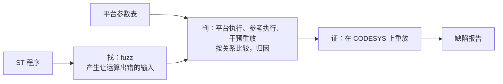

# 计划书

2026-10-18

本文依据[研究方向](research_direction_zh.md)，结合现有的 SemantiST，列出从现在到投稿的全部工作：分几个阶段，每个阶段做什么、产出什么、怎样算完成，以及没有通过时怎么办。第 1 周从 2026-10-19 算起。

## 0. 总览

工具做完后的完整流程：

| 阶段 | 内容 | 时间 | 关口 |
| --- | --- | --- | --- |
| 0 | 基础修复 | 已完成 | — |
| 1 | 判据验证：用 10–20 个小例子证明能分清故意和有害 | 第 1–2 周 | G1 |
| 2 | 平台参数表、虚拟时钟、原生确认流程 | 第 2–4 周 | G2 |
| 3 | 自动化判定器，接入 fuzz | 第 5–8 周 | G3 |
| 4 | 应用级案例 | 第 7–9 周 | — |
| 5 | 正式评测 | 第 10–13 周 | G4 |
| 6 | 写作与披露 | 贯穿始终，第 14 周起为主 | — |

## 1. 现有工具的角色

| 组件 | 现在能做什么 | 在新方向中的角色 | 要做的改动 |
| --- | --- | --- | --- |
| RuSTy 编译、STG 与 IR 插桩（`compiler/`） | 找出每个有风险的运算，并在运行时判断它是否出错：除法、整数溢出、浮点非有限值、数组越界、截断 | "找"：标记第一层的运算出错 | 整数溢出改为按参数表中的中间结果宽度判断 |
| harness 生成（`compiler/harness/`） | 布局取自编译器；FB 可以连续跑多个扫描周期 | "找"和"判"共用 | 加虚拟时钟 |
| fuzz 引擎（`fuzzer/engine/`、`fuzzer/semantic/`、`fuzzer/scheduler/`） | 把输入引向风险点，到达出错点就保存输入，在线去重 | "找" | 进展度量改为到出错边界的距离 |
| 重放与分类（`fuzzer/reporting/`、`experiments/comparison/analysis/replay.py`） | 重放崩溃，并分为工具链 panic、harness 错误、目标缺陷 | "判"的入口 | 扩展为判定流程 |
| 对比实验框架（`experiments/comparison/`） | 运行 SemantiST、AFL++、ICSQuartz，统一导出指标 | 评测中的"生成器" | 补齐 ICSQuartz 的输入转换；解决 AFL++ 拒绝会崩溃的初始种子、local-bounds 检测只在 SemantiST 构建中启用的问题 |
| 基准（`benchmarks/`） | 90 个目标：OSCAT Basic 61 个（31 个 FUNCTION、30 个 FB），ICSQuartz 注入缺陷的基准 29 个 | OSCAT 部分进开发集；ICSQuartz 部分以内存越界为主，不在第一版范围内，只用来检查搜索能力没有退化 | 无 |
| 普查 CSV（`docs/improvement/*.csv`）与 7 个已知问题 | 人工审计的结果 | 开发集真值 | 整理成机器可读的格式 |
| 校准包（`experiments/calibration/`） | CODESYS 与 RuSTy 的逐项对照 | 产出平台参数表 | 补上 CODESYS 的结果 |

**新增的部分**：判据验证集、平台参数表、虚拟时钟、可切换语义构建、关系比较、干预重放、原生确认流程。

**保留但不再投入的部分**：路径搜索与五维 effort 公式、复杂的抽象状态遥测、快进、LLM 报告文本。

## 2. 阶段 0：基础修复（已完成）

- 已完成的修复：
  - harness 布局改为取自编译器；
  - `ADR(x) + n` 改为按字节计算；
  - 崩溃按签名去重，并记录首次发现时间；
  - 重放时对崩溃分类；
  - 修复变异器把 64 位整数当成 LREAL 的 bug；
  - 修复重放预算误含容器启动时间的问题。
- 在新镜像上跑的 smoke 和 P0 验证都已通过，详见[现状说明](project_status_20261018_zh.md)。
- 校准包已完成，RuSTy 一列已填好。

**遗留：**

- 有 15 个修改前就失败的 Python 测试；
- `fix/p0-harness-fidelity` 尚未合并到 main。

## 3. 阶段 1：判据验证（第 1–2 周）

**目的。** 在做任何自动化之前，先证明研究方向中"判"这一步的做法能分清故意和有害。这是整个方向能否成立的关口。

**做法。**

- 写 10–20 个小例子。每个例子包括：
  - 被测的 ST 代码；
  - 手写的可切换语义版本：每个风险运算都改成调用一个辅助函数，由开关决定取平台值还是正确值。它的形式与阶段 3 自动生成的相同，相当于变换规则的手工原型；
  - 输入序列；
  - 人工标注的期望结论（属于三层中的哪一层）和期望归因（是哪一次运算）。
- 写一个小驱动，对每个例子逐周期运行三种模式：
  - 平台执行：全部取平台值；
  - 参考执行：全部取正确值；
  - 干预重放：只改正指定的那几次运算。

  驱动记录持久变量和输出，按关系比较，给出结论和归因。
- 在实验镜像中用 RuSTy 编译运行，方式与校准包相同，不改编译器。
- 代码放在 `experiments/criterion/`。

**例子要覆盖的情况：**

| 情况 | 例子 | 期望 |
| --- | --- | --- |
| 故意的模运算 | 时钟模差写法（A1）；显式窄化；校验和 | 不报 |
| 有害的回绕 | 累计量溢出，使报警失效；计数器回绕，使步骤跳错 | 报告，并归因到对应的运算 |
| 跨周期传播 | 第 k 周期出错，第 k+m 周期才改变输出 | 报告，并给出传播过程 |
| 出错被覆盖 | 错的值在影响输出之前被复位覆盖 | 不报 |
| 多次出错 | 同一周期 a、b 都溢出，只有 b 影响输出 | 只归因到 b |
| 出错互相抵消 | 两次回绕互相抵消，输出不变 | 不报 |
| 等价的两种写法 | 赋值时隐式转换，与使用显式转换函数 | 记录两者结论是否一致。按现有规则可能不一致，要把它测出来 |
| 依赖平台的情况 | `IF a + b > LIMIT` 这类不赋值的中间结果；除零是陷入还是返回 0 | 期望值等 CODESYS 的校准结果 |

**关口 G1（第 2 周末）：**

- **通过**：所有不涉及平台的例子，结论和归因都与人工标注一致。涉及平台的例子，在阶段 2 拿到校准结果后补测。
- **不通过**：分析原因。
  - 如果是规则写得不对，修改后重试一次；
  - 如果是方法本身分不清，就停下来重新考虑方向。备选是收缩为"测量＋平台校准"的论文，或转向 online change。

**产出**：用例集、驱动、结果表、可切换语义的变换规则草案。

## 4. 阶段 2：平台参数表与原生确认（第 2–4 周）

可以和阶段 1 部分并行，校准由你在 CODESYS 上运行。

**4.1 CODESYS 校准。** 你按 `experiments/calibration/README_zh.md` 运行，我整理结果、分析差异。

**4.2 平台参数表。** 文件暂定放在 `platforms/codesys_control_win_x64.json`，条目包括：

- 中间结果的宽度，以及截断发生在哪里；
- 各整数类型 DIV、MOD 除以零时的行为，以及除法溢出（最小值除以 -1）；
- REAL 转整数越界的结果，以及取整方式；
- TIME、DATE、DT、TOD 的位宽、单位和回绕方式；系统时钟的来源和回绕；
- STRING 的长度上限和编码，以及字符串函数参数越界时的行为；
- 浮点除零，以及 NaN、INF。

每一条都注明依据的校准用例编号。

**4.3 虚拟时钟。** harness 中的 `TIME()`、`T_PLC_MS()` 等由输入序列提供：输入里包含时钟起点和每个周期的时间步长。起点可以设在回绕点附近，让时钟回绕在几个周期内就能发生。这同时解决了 RMP_B 在重放时无法复现的问题。

**4.4 原生确认流程（先半自动）。**

1. 脚本根据输入序列生成一个 CODESYS 测试程序：逐周期把输入交给被测 POU，把输出记到 RETAIN 数组里，做法和校准包相同；
2. 你导入运行，导出结果或截图；
3. 脚本把 CODESYS 的输出与我们的平台执行逐周期比较。一致，说明平台执行可信；再与参考执行比较，就能确认缺陷。

以后如果需要确认的数量大，再考虑用 CODESYS 的脚本接口或文件库自动导出结果。

**4.5 补测。** 用 4.4 的流程，把阶段 1 中依赖平台的例子在 CODESYS 上跑一遍，确定它们的期望值。

**4.6 开发集真值。** 把普查 CSV 和 7 个已知问题整理成机器可读的格式，标明来源是人工审计，并逐条按参数表复核。涉及中间结果的条目（如 F_LAMP 的 `UINT * 3600`、FRMP_B 中 `SHL` 的结果）要按校准结果重新判断。G3 和 RQ1 都要用到它。

**关口 G2（第 4 周末）：**

- 参数表的每一条都有 CODESYS 实测支撑；
- 在阶段 1 的例子上，平台执行与 CODESYS 的输出逐周期一致。

确认不了的条目，从第一版范围中排除。

## 5. 阶段 3：自动化判定器（第 5–8 周）

### 5.1 可切换语义构建（自动生成）

把阶段 1 手写的形式自动化。推荐在 ST 源码层做变换，理由是：

- **与执行器无关**：变换后仍是 ST，RuSTy、MATIEC 或其他编译器都能编译，符合研究方向；
- **加宽变量类型**在源码层做最简单；
- **类型和位置信息现成**：每个风险运算的类型和位置，STG 已经从 RuSTy 的类型信息中拿到了；
- **便于排查**：必要时，变换后的程序可以直接放到 CODESYS 上运行。

备选方案是在 LLVM IR 上做影子值（Herbgrind 的做法）。它更通用，但工作量大，而且绑定在 LLVM 上。阶段 1 结束时再定。

变换规则：

- 被测 POU 及其依赖的函数中，整数变量都加宽，用来保存正确值；
- 每个风险运算（隐式算术、隐式转换、除法、REAL 转整数、TIME 运算）都改为调用辅助函数：先按参数表算出平台值，再按开关决定取平台值还是正确值；
- 显式窄化、位运算、移位，两边都按模计算；
- 标准库函数提供对应的版本；
- 第一版范围之外的写法（指针、`ADR`、`SIZEOF`、`MEMCPY` 等）记为不支持并退出，支持率公开报告。

正确性检查分两部分：

- 开关全部取平台值时，结果应当与原始构建一致，这一项只适用于不涉及平台差异的程序；
- 抽样与 CODESYS 原生运行比较。

### 5.2 关系比较

为每个持久变量和输出指定比较方式：时钟派生的量按模 2^w 比较，其余按值比较。一个量是否由时钟派生，先按类型和赋值来源的简单规则判断；判断不了的标为"不确定"，并报告这类量的比例。

### 5.3 干预重放与归因

把每次出错记为（周期，位置），然后：

1. 先把出错全部改正，确认后果消失；
2. 再用二分（Delta Debugging）找出造成后果所必需的最少几次出错；
3. 输出传播过程：经过了哪些持久变量，在第几个周期影响了哪个输出。

每个输入的重放次数设上限，所用时间计入总预算。

### 5.4 接入 fuzz

在线 fuzz 只负责"找"：到达出错点就保存输入，这部分已经有了。判定离线进行：

1. 去重；
2. 平台执行与参考执行；
3. 关系比较；
4. 干预归因；
5. 分层给出结论；
6. 生成待确认清单；
7. 按 4.4 做原生确认。

结果按（出错位置，传播过程）去重。把"找"和"判"分开，也便于评测时把其他工具产生的输入交给同一个判定器。

### 5.5 搜索侧的小改动

以到出错边界的距离作为进展，替换现在的 affinity 进展。例如 `x + 1 > 32767` 的距离就是 `32767 - x`。前缀保持作为可选项，单独评估。

### 5.6 报告格式

按研究方向第 4 节的要求，每份报告包括：触发输入、出错的运算、传播过程、原生复现记录。

**关口 G3（第 8 周末）：**

- 自动生成的构建，在阶段 1 的全部例子上得到与手写版本相同的结论；
- 在开发集上，能找回第一版范围内的已知问题。

不满足就缩小支持范围。

## 6. 阶段 4：应用级案例（第 7–9 周）

- **选案例。** 选一个有明确控制性质的真实 PROGRAM，例如用 OSCAT 的计数、计时、滤波功能块实现的控制逻辑。优先从开源工程中选；需要自己搭建时，要贴近真实场景，不能人为制造脆弱的调用方。
- **走完证据链：**
  1. 攻击者能影响的输入，以及攻击者为什么能写它；
  2. 满足应用约束的扫描历史；
  3. CODESYS 上的错误行为；
  4. 被违反的报警、联锁或控制性质。
- **目标。** 说明新判定方法找到的问题有控制或安全上的意义。

## 7. 阶段 5：正式评测（第 10–13 周）

### 7.1 数据

| 集合 | 内容 | 用途 |
| --- | --- | --- |
| 开发集 | OSCAT Basic 的 61 个目标、普查候选、7 个已知问题 | 设计和调整规则，不算工具的新发现 |
| 留出集 | 按函数家族和共享依赖，从 OSCAT 中划出规则设计时没用过的部分 | 规则冻结后才运行。普查覆盖了三个库，留出集的独立性有限，要在论文中说明 |
| 外部项目 | 没有审计过的开源 ST 库与工程 | 新发现的主要来源。清单在阶段 3 期间选定并冻结 |

### 7.2 冻结

规则和参数表冻结之后，再运行留出集和外部项目。

### 7.3 生成器 × 判定器

- **生成器**：SemantiST、AFL++、ICSQuartz；
- **判定器**：崩溃、运算出错、我们的后果判定。

所有生成器产生的输入都交给同一个判定器，这样能分开看"找"和"判"各自起了多大作用。

### 7.4 研究问题

| 问题 | 内容 |
| --- | --- |
| RQ1 判得对吗 | 在判据验证集、75 个使用模差写法的 POU、等价改写对上的误报和不一致；在开发集真值上的召回 |
| RQ2 找得到吗 | 各组合下按根因去重的第二、三层发现；崩溃判据漏掉了多少，又误报了多少 |
| RQ3 在真实 PLC 上成立吗 | 原生确认率；崩溃判据所报告的崩溃中，在 CODESYS 上不成立的比例（注明只代表基于 RuSTy 的流程） |
| RQ4 各部分是否必要 | 消融：分别去掉关系比较、干预归因、平台参数表、进展度量 |
| RQ5 代价 | 判定所用时间占总预算的比例 |
| RQ6 真实影响 | 第三层缺陷、维护者的确认、应用级案例 |

### 7.5 统计

- 每组至少运行 10 次，交错调度；
- 首次发现时间用生存分析；
- 组间比较用 Mann–Whitney U 和 Â12。

### 7.6 可选：第二张参数表

如果能用上另一种运行时或硬件，就测第二张参数表，展示同一个程序在不同平台上的结论如何变化，以此支撑"换平台只换表"。

## 8. 阶段 6：写作与披露

- 阶段 1 结束后写出引言和图 1 的初稿，用写故事倒逼后续工作；
- 确认的缺陷向 OSCAT 维护方和 CERT@VDE 披露；
- 准备 artifact：镜像、参数表、用例、脚本。

## 9. 分工与时间线

| 周 | 我 | 你 |
| --- | --- | --- |
| 1–2 | 阶段 1 | 在 CODESYS 上运行校准包 |
| 3–4 | 阶段 2：参数表、虚拟时钟、原生确认脚本；引言初稿 | 运行原生确认程序；提供 OSCAT 原始源文件 |
| 5–6 | 阶段 3 前半：源码变换、关系比较 | 选定外部项目 |
| 7–8 | 阶段 3 后半：干预归因、接入 fuzz；阶段 4 选定案例 | 参与选定应用级案例 |
| 9 | 阶段 4 | 在 CODESYS 上完成案例的证据链 |
| 10–13 | 阶段 5 | 原生确认 |
| 14 起 | 写作、披露 | 写作、披露 |

## 10. 关口汇总

| 关口 | 时间 | 通过条件 | 不通过时 |
| --- | --- | --- | --- |
| G1 判据验证 | 第 2 周末 | 不涉及平台的例子，结论和归因全部正确 | 修改规则后重试一次；仍不行就收缩为测量论文，或转向 online change |
| G2 平台可信 | 第 4 周末 | 参数表有实测支撑；平台执行与 CODESYS 逐周期一致 | 修正参数表或变换；确认不了的条目移出范围 |
| G3 自动化 | 第 8 周末 | 自动构建重现阶段 1 的结论；在开发集上找回已知问题 | 缩小支持范围 |
| G4 投稿档次 | 第 13 周末 | 见下 | 投 CCF-B |

G4 走顶会（NDSS、USENIX Security），需要同时满足：

- 第三层缺陷分布在多个函数家族或项目中，而不是同一个模式的重复；
- 至少有一个案例完成了原生平台上的完整安全证据链；
- 关系比较或干预归因在消融实验中有清楚的贡献。

否则投 CCF-B，首选 DSN，其次 ACSAC、RAID。

## 11. 需要你决定或提供的

1. 在 CODESYS 上运行校准包。
2. 阶段 3 的实现层次：推荐 ST 源码层，阶段 1 结束时定。
3. 是否做第二张参数表，以及有没有可用的设备或运行时。
4. 外部项目：手头有没有可用的 ST 工程。
5. OSCAT Building、Network 的原始源文件，以及与普查 CSV 行号对应的 `oscat_basic.st`。
6. `fix/p0-harness-fidelity` 是否合并到 main。
